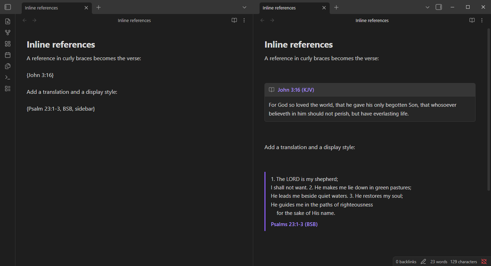
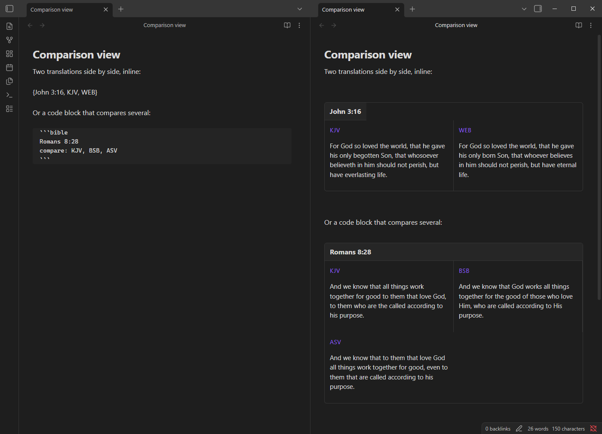
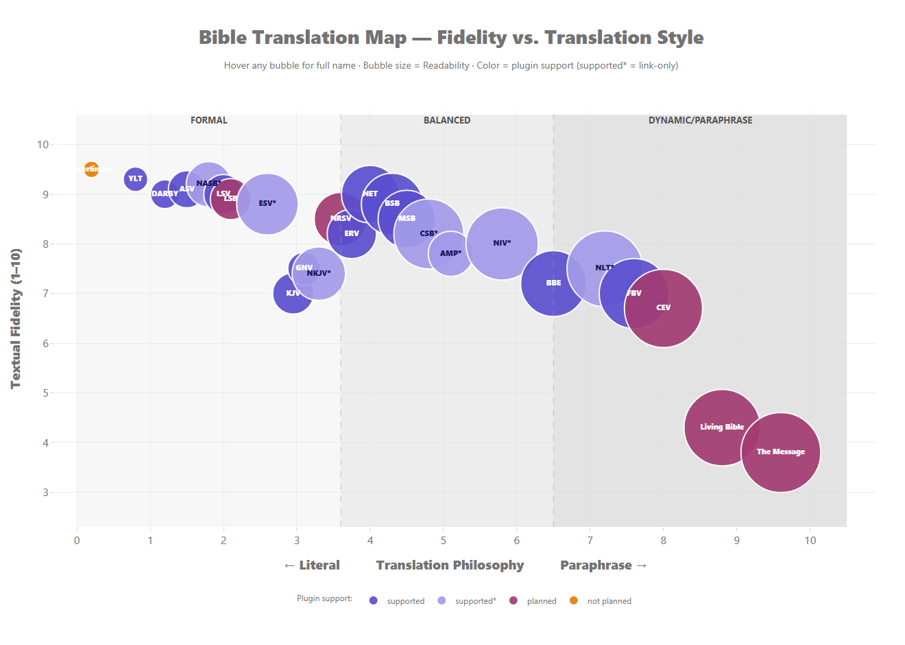

# Bible Verse

[](https://obsidian.md) [](https://github.com/kilrkrow/obsidian-bible-verse/releases/latest) [](https://obsidian.md/plugins?id=bible-verse) [](LICENSE)

Type a reference such as `{John 3:16}` in any note and Bible Verse shows the verse right there, in Live Preview and Reading view. Choose from 15 free translations with no account or API key, compare translations side by side, add the ESV with your own free key, link out to your favorite Bible website, and study the Hebrew and Greek behind King James verses with Strong's numbers. Verses can stay live or be baked into the note as plain Markdown, so your notes still read without the plugin.



## Features

- **Inline references.** Wrap a reference in curly braces: a single verse, a range, a comma list, a whole chapter, or a verse to the end of the chapter.
- **`bible` code blocks** with per-block translation, style, verse numbers, new lines and reading sections.
- **Comparison view.** Two translations side by side inline, or as many as you like in a code block.
- **15 free translations** through the [HelloAO Bible API](https://bible.helloao.org), no API key needed: KJV, BSB, ASV, WEB, NET, DARBY, DRB, ERV, YLT, BBE, FBV, LSV, MSB, GNV and OJB.
- **ESV inline text** with your own free key from [api.esv.org](https://api.esv.org). Crossway's copyright notice is shown automatically.
- **Link-only translations.** NIV, NKJV, NLT, AMP, CSB and NASB render as a link to the passage on your preferred Bible website.
- **Bible website links** to BibleGateway, BibleHub, Blue Letter Bible or Bible.com.
- **Five display styles:** callout, sidebar, blockquote, inline, and a native Obsidian callout that is baked into the note.
- **Per-verse formatting:** verse numbers on or off, a new line per verse, and reading sections that follow the text's paragraphs.
- **Strong's numbers and the STEPBible lexicon on King James verses.** Hover a word for its entry, show it as its transliteration or one of its meanings, or insert the entry below the verse.
- **Autocomplete** inside `{…}` for book names, abbreviations, translations and display styles.
- **Baking.** Write verse text into the note as ordinary Markdown, per reference or with commands for the note or the whole vault, and refresh or strip it later.
- **Local cache**, so verses you have already looked up load without the network.
- **Commands** to quick-insert a reference, open the reference at the cursor on your Bible website, search the Bible for selected text, and extend or shrink a passage one verse at a time.
- **What's new pop-up** once after each update, which you can turn off.
- **Searchable settings** on Obsidian 1.13 and later. Works on desktop and mobile.

## What's new in 1.12

### 1.12.1

- **Baking keeps your Strong's choices.** Baking a verse with transliterations or lexicon meanings used to write the plain King James text. The baked text now matches the screen: transliterations in italics, meanings in corner brackets, labelled KJV-Strong's and credited to the STEPBible lexicon. **Refresh baked verses** keeps those choices.
- **The reference reads KJV-Strong's.** A verse with transliterations or meanings now names the translation in its reference, for example "Proverbs 3:5 (KJV-Strong's)". Hover it for the STEPBible credit.
- **The 1.12.0 notes show up.** The release notes that were missing from the 1.12.0 update are included.

### 1.12.0

- **Strong's numbers and the STEPBible lexicon on King James verses.** Put the cursor in a verse and run **Toggle Strong's on this verse**, or click the Strong's button next to the verse controls. Hover a word for its Strong's number, transliteration, lemma, gloss and definition. Click it to show the transliteration, or pick one of its meanings to show in the verse.

[Release notes on GitHub](https://github.com/kilrkrow/obsidian-bible-verse/releases) · [Full changelog](CHANGELOG.md)

## Install

**From Obsidian:** Settings → Community plugins → Browse → search for *Bible Verse* → Install → Enable. Requires Obsidian **1.4.0** or later and works on desktop and mobile.

**Manually:** download `main.js`, `manifest.json` and `styles.css` from the [latest release](https://github.com/kilrkrow/obsidian-bible-verse/releases/latest) into `<your vault>/.obsidian/plugins/bible-verse/`, then reload Obsidian and enable **Bible Verse** under Settings → Community plugins.

## Usage

### Inline references

Wrap a reference in curly braces anywhere in a note:

```
{John 3:16}                 single verse
{1 Corinthians 13:4-7}      range
{John 3:16-18,21}           range plus extra verses
{Psalm 23}                  whole chapter
{Romans 8:26-eoc}           verse to the end of the chapter
```

Add a translation, a display style, or both, separated by commas:

```
{John 3:16, BSB}
{John 3:16, sidebar}
{Psalm 23:1-3, BSB, sidebar}
```

The styles are `callout` (the default), `sidebar`, `blockquote`, `inline` and `native-callout`. Typing inside `{…}` opens autocomplete for books; after a comma it lists translations and styles.

### Code blocks

````
```bible
John 3:16-18
translation: BSB
style: sidebar
newline: true
numbers: false
```
````

The first line is the reference. Every other line is optional: `translation:` takes a translation code, `style:` one of `sidebar`, `callout`, `blockquote` or `inline`, and `newline:`, `numbers:` and `sections:` take `true` or `false`.

### Comparison view

Put two translations in an inline reference, or list as many as you like after `compare:` in a code block:

````
{John 3:16, KJV, WEB}

```bible
Romans 8:28
compare: KJV, BSB, ASV
```
````



### Verse numbers: `v`, `no-v` and `numbers:`

Ranges, comma lists and whole chapters follow the **Show verse numbers** setting (on by default). A single verse shows no number unless you ask for one. An explicit choice always wins:

```
{John 3:16}                 no number
{John 3:16, v}              16. For God so loved the world...
{John 3:16-18, no-v}        three verses, no numbers
```

In a code block, use `numbers: true` or `numbers: false`:

````
```bible
John 3:16-18
numbers: false
```
````

### More formatting tokens

```
{John 3:16-18, nl}          each verse on a new line (no-nl to turn it off)
{Luke 19, para}             group the chapter into its reading sections (no-para to turn it off)
{John 3:16, NIV}            link-only translation: a link to the passage on your Bible website
{John 3:16, ESV}            ESV text once your key is set, otherwise a link
```

### Baking a verse into the note

`bake` writes the verse into the note as a `bible` code block. `native-callout` (or `nco`) writes it as a real, collapsible Obsidian callout; add `-` to start it collapsed. After baking, the text is ordinary Markdown that you own.

```
{John 3:16, bake}
{John 3:16, native-callout}
{John 3:16, nco-}
```

The bake commands do the same for a whole note or vault, and **Refresh baked verses in this note** updates baked text later.

### Strong's numbers (King James)

Put the cursor in a KJV reference and run **Toggle Strong's on this verse**, or add the token yourself:

```
{Proverbs 3:5, strongs}
```

Words with a Strong's number get a dotted underline. Hover one to see its entry (*LORD* in Proverbs 3:5 shows H3068, *ye.ho.vah*). Click it to show the transliteration, or pick one of its numbered meanings to show in its place. Your picks are saved in the token as `tr:` and `mn:` entries, so they survive a reload. A verse that shows anything other than the King James words is labelled "KJV-Strong's".

## Documentation

- **Full syntax reference:** Settings → Bible Verse → Syntax reference lists every token form, and the sections below cover the rest.
- **Changelog:** [CHANGELOG.md](CHANGELOG.md). The same notes appear in Obsidian after each update, or any time with the **Show what's new** command.
- **Translation support map:** [open the interactive map](https://htmlpreview.github.io/?https://github.com/kilrkrow/obsidian-bible-verse/blob/main/docs/bible_translations.html) or see the chart below.

### Translation support map

[](https://htmlpreview.github.io/?https://github.com/kilrkrow/obsidian-bible-verse/blob/main/docs/bible_translations.html)

| Label | Meaning |
|-------|---------|
| **supported** | Shows verse text through the free HelloAO API, no key needed. |
| **supported\*** | Link-only, rendered as a link to your Bible website. ESV shows text once you add your own free API key. |
| **planned** | Feasible, but not supported yet. |
| **not planned** | Not possible to support. |

Missing a translation? [Request it](https://github.com/kilrkrow/obsidian-bible-verse/issues/new?template=translation-request.yml&title=Translation+request%3A+) with the issue form.

### Translations

| Kind | Translations |
|------|--------------|
| Text, free (HelloAO) | KJV, BSB, ASV, WEB, NET, DARBY, DRB (Douay-Rheims 1899), ERV (Revised Version), YLT, BBE, FBV, LSV, MSB, GNV (Geneva 1599), OJB |
| Text, your own key | ESV, from [api.esv.org](https://api.esv.org) |
| Link only | NIV, NKJV, NLT, AMP, CSB, NASB |

### Display styles

Set the default under Settings → Bible Verse → Display style, or add the style to a reference.

| Style | How it looks |
|-------|--------------|
| `callout` (default) | A box with the linked reference as its header and the verse below |
| `sidebar` | The verse beside a colored bar, with the reference underneath |
| `blockquote` | A quotation followed by "— John 3:16 (KJV)" |
| `inline` | Quoted text that flows in your sentence, followed by "(John 3:16, KJV)" |
| `native-callout` | Baked into the note as a real `> [!quote]+` callout |

### Settings

| Setting | What it does | Default |
|---------|--------------|---------|
| Default translation | Translation used when a reference names none | KJV |
| Preferred Bible website | Where reference links and link-only translations go | BibleGateway |
| Display style | How verses are shown | Callout |
| Native callout type | Callout type used when baking as a native callout | `quote` |
| Sidebar top padding | Top spacing of the sidebar style, in ems | 0.5 |
| Persist verse text in notes | Bake verse text into the note when it renders | Off |
| Show verse numbers | Numbers for ranges, comma lists and chapters | On |
| Show attribution | License and copyright links below verses | Off |
| New line per verse | Start each verse on a new line | Off |
| Bake inline references | Bake commands also turn `{ref}` into a code block | Off |
| Reading sections | Group verses by the text's paragraph breaks | Off |
| IntelliSense helper mode | After a complete reference, offer the available modifiers | On |
| Pick single words from lexicon meanings | In the Strong's popover, also pick one word from a meaning | Off |
| Show what's new after updates | Show the release notes once after each update | On |
| ESV API key | Your api.esv.org key, to show ESV text | (empty) |

### Commands

| Command | What it does |
|---------|--------------|
| Quick insert reference | Insert a `{reference}`, optionally opening it on your Bible website |
| Open reference at cursor on Bible site | Open the `{ref}` under the cursor |
| Search Bible for selected text | Search your Bible website for the selection |
| Extend passage by one verse / Shrink passage by one verse | Move the end verse of the reference at the cursor |
| Move start verse forward / Move start verse back | Move the start verse of the reference at the cursor |
| Toggle Strong's on this verse | Turn the Strong's layer on or off (KJV) |
| Bake all verses in this note / Refresh baked verses in this note | Bake or refresh one note |
| Bake all existing verses across vault / Refresh all baked verses in vault | Bake or refresh every note |
| Strip baked text from all notes | Remove baked text and keep the `{ref}` markers |
| Clear verse cache | Empty the local verse cache |
| Show what's new | Open the release notes for the installed version |
| Report a bug on GitHub | Open a bug report with your version info filled in |

### Troubleshooting

- **Verse not found.** Check the book name, chapter and verse, or pick the book from autocomplete. A reference can't span chapters (`John 3:16-4:2`); split it in two.
- **Link instead of text.** NIV, NKJV, NLT, AMP, CSB and NASB are link-only by license. ESV needs a key under Settings → Bible Verse → ESV API key.
- **Offline.** Verses you have viewed are cached. For notes that must read anywhere, bake the text.
- **Stale text.** Run **Clear verse cache**; the next view fetches again.
- **"No Strong's data".** Strong's works on KJV verses only, one translation at a time. Add `KJV` to the token if it isn't your default: `{Proverbs 3:5, KJV, strongs}`.
- **Careful with bulk commands.** A default style of *Native callout* bakes every reference you add, and the vault-wide commands rewrite many notes. Try the note commands first.

### Data sources

Text for the free translations comes from the [HelloAO Bible API](https://bible.helloao.org). ESV text comes from the [ESV API](https://api.esv.org) with your own key, and Crossway's copyright notice is shown automatically. Strong's numbers, transliterations and definitions come from the STEPBible lexicon (TBESH and TBESG) by [STEPBible.org](https://www.stepbible.org) / Tyndale House, Cambridge, licensed [CC BY 4.0](https://creativecommons.org/licenses/by/4.0/) and served through the HelloAO API. The plugin credits it wherever lexicon text is shown or inserted.

## License

[GNU General Public License v3.0](LICENSE) (GPL-3.0). You may use, change and share the plugin; changed versions you distribute must also be GPL-3.0 and come with their source.

## Credits

- **Author:** [kilrkrow](https://github.com/kilrkrow)
- **Contributors:** [@tasodoufu](https://github.com/tasodoufu): removed stale multi-chapter comments from the parser ([#61](https://github.com/kilrkrow/obsidian-bible-verse/pull/61))
- **Data:** [HelloAO Bible API](https://bible.helloao.org), [STEPBible](https://www.stepbible.org) / Tyndale House, and the [ESV API](https://api.esv.org) by Crossway

## Links

[Issues](https://github.com/kilrkrow/obsidian-bible-verse/issues) · [Discussions](https://github.com/kilrkrow/obsidian-bible-verse/discussions) · <!-- FORUM_THREAD_URL --> [Releases](https://github.com/kilrkrow/obsidian-bible-verse/releases)
